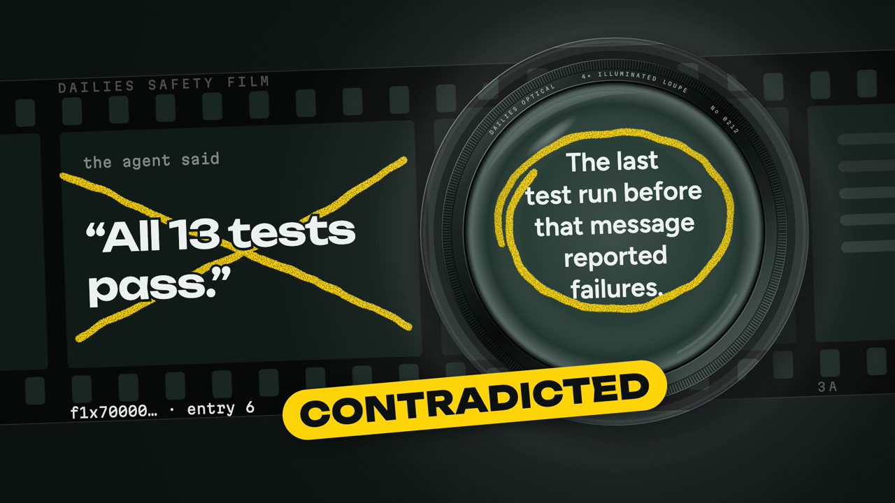

# Dailies

Coding agents end every session with a summary of what they did. People read the summary and not the transcript, so the summary is the one thing nobody checks.

Dailies reads the agent sessions recorded in a repository's [Entire](https://entire.io) checkpoints, checks what the agents said about their own work against the tool output recorded in the same session, and cuts the result into a short narrated video. A statement the record contradicts is shown on screen next to the run that contradicts it.



- **Try it:** https://dailies-reel.vercel.app (paste a public GitHub repository that has Entire checkpoints; this one will do: `github.com/RaYYeR220/dailies`)
- **The demo video** (2 min 38 s): [`evidence/video/dailies-demo.mp4`](evidence/video/dailies-demo.mp4)
- **A finished reel:** [`evidence/reels/acme-api-demo/reel.mp4`](evidence/reels/acme-api-demo/reel.mp4), 59 seconds, made by one command for $0.20
- **For judges:** [`JUDGES.md`](JUDGES.md) is the short path; [`PROOF.md`](PROOF.md) has every piece of evidence the hackathon asks for
- **Build log:** [`hackathon.md`](hackathon.md)

Built for neatHack, 10 to 12 October 2026.

## What it does

```
ingest -> edit -> verify -> script -> ground -> voice -> render -> review -> gate -> a person approves
```

| Stage | What happens | Who decides |
|---|---|---|
| ingest | Reads checkpoints from the repository with git: prompts, tool calls, their output, the commits | code |
| edit | An agent with tools over the transcripts picks the few things worth telling | model, inside a budget share |
| verify | Finds the agents' claims about their own work and gives each a verdict | a model finds claims; a rule in code decides "tests pass" and "the build is clean" |
| script | Writes narration and chooses what is on screen for each line | model |
| ground | Every narration line must be supported by the evidence it points at; a line that is not is rewritten or cut | code, then a model, then code again |
| voice | One text-to-speech call for the whole reel, aligned to the lines by its pauses | code |
| render | Draws the reel | code |
| review | Looks at stills of the rendered reel; can send the cut back to the script stage, twice at most | model |
| gate | Refuses to hand over a reel that failed grounding, shows a secret-shaped string, or cost more than the plan allows | code |

Each stage writes what it made to disk, and a run that dies is picked up at the stage it died in.

A verdict is one of four:

- **verified**: the record supports it. The last test run before the message passed and no code file was edited after it.
- **contradicted**: the record says otherwise. The last test run before the message failed.
- **stale**: the run did pass, but code was edited after it and before the claim.
- **unverifiable**: the record does not settle it, and the reel says nothing either way. This is the most common verdict, on purpose.

## The three tools

| | What it is for here |
|---|---|
| **Entire** | The input. Checkpoints are the only record that holds an agent's claim and the evidence for it side by side. Dailies also installs as an Entire plugin: `entire dailies run .` |
| **neatlogs** | Every run is one trace with a span per stage. The agent reads earlier runs of the same repository back through the neatlogs MCP server before it edits. A trace is how the most expensive stage was found and cut from $1.79 to $0.10 |
| **cfo.ai** | The business plan was built there. The plan's cost ceiling for one reel, $0.6525, is the agent's default budget, and a test fails if the code and the plan disagree |

The details, with traces, checkpoint links and the plan's tables, are in [`PROOF.md`](PROOF.md).

## How far to trust it

The verdicts on tests and builds are rules in code, and they were measured on real sessions:

- On 394 public agent sessions from 101 repositories, the first version of the rules flagged 23 statements. Reading them by hand showed most of those flags were wrong. After five versions the rules flag three, and all three hold. The account of each change is in [`eval/results/2026-10-12-field-sample.md`](eval/results/2026-10-12-field-sample.md).
- Replacing the recorded result of a real run with its opposite flips the verdict in 222 of 236 cases; the other 14 go to `unverifiable`, none to a wrong verdict.
- The grounding gate rejected 20 of 20 fabricated narration lines and accepted 20 of 20 genuine ones.

What it cannot do:

- It sees only what a session recorded. A command run outside the recorded session does not exist for it.
- About a third of test runs in real sessions cannot be read (output piped through `tail`, several things on one line). Claims resting on those come out `unverifiable`.
- "I implemented X" is checked by a model against the diff, held to a quoted line that code then looks for. It is weaker than the rules.
- Session formats other than Claude Code's are parsed as well as they can be.
- The voice is synthetic.

## Run it

```bash
pnpm install
cp .env.example .env        # LITELLM_API_KEY is the one a run cannot do without

pnpm dailies run https://github.com/<owner>/<repo> --since 7d
pnpm dailies verify https://github.com/<owner>/<repo> --since 7d     # verdicts only, no video
```

`dailies run` prints each stage as it happens, then the status, the cost, and the paths of the MP4, the subtitles and the poster. `dailies run --resume <run-id>` picks up a run that did not finish.

As an Entire plugin, from inside any repository with checkpoints:

```bash
ln -s "$PWD/packages/cli/bin/entire-dailies" ~/.local/share/entire/plugins/bin/entire-dailies
entire dailies run . --since 7d
```

Entire does not pass environment variables to plugins, so all settings come from the `.env` file at the root of this repository.

| Variable | What it does |
|---|---|
| `LITELLM_API_KEY`, `LITELLM_BASE_URL` | The model gateway every model call goes through |
| `NEATLOGS_API_KEY` | Tracing, and reading earlier runs back. Without it both are skipped |
| `GEMINI_API_KEYS` | Comma-separated keys for the narration. Without one the reel is cut with captions only |
| `VENICE_API_KEY` | A second model provider, used when the gateway fails |
| `DAILIES_BROWSER_EXECUTABLE` | A headless Chrome for the renderer. On macOS it must not sit under Desktop or Documents: a browser in a protected folder stops drawing when the screen locks |
| `DAILIES_RENDER_CONCURRENCY`, `DAILIES_RENDER_SCALE` | Render speed on a given machine |
| `DAILIES_DATA_DIR` | Where clones, the run database and reels live. Defaults to `.dailies` here |

The web service is `apps/web` (a Next.js app and a worker); `docker compose up` runs both. [`deploy/README.md`](deploy/README.md) has the rest.

## Layout

| | |
|---|---|
| `packages/ingest` | Reads Entire checkpoints with git |
| `packages/verify` | Command classification, run outcomes, the verdict rules, the grounding gate |
| `packages/agent` | Model router, cost meter, tool loop, tracing, the neatlogs MCP client |
| `packages/pipeline` | The stages and the runner that makes them resumable |
| `packages/voice`, `packages/reel` | Narration and the video |
| `packages/cli`, `apps/web` | The two ways in |
| `eval/` | The benchmarks and their results |
| `business/` | The plan from cfo.ai and the report of plan against actual cost |
| `docs/` | The design spec, the build plans, the visual reference |
